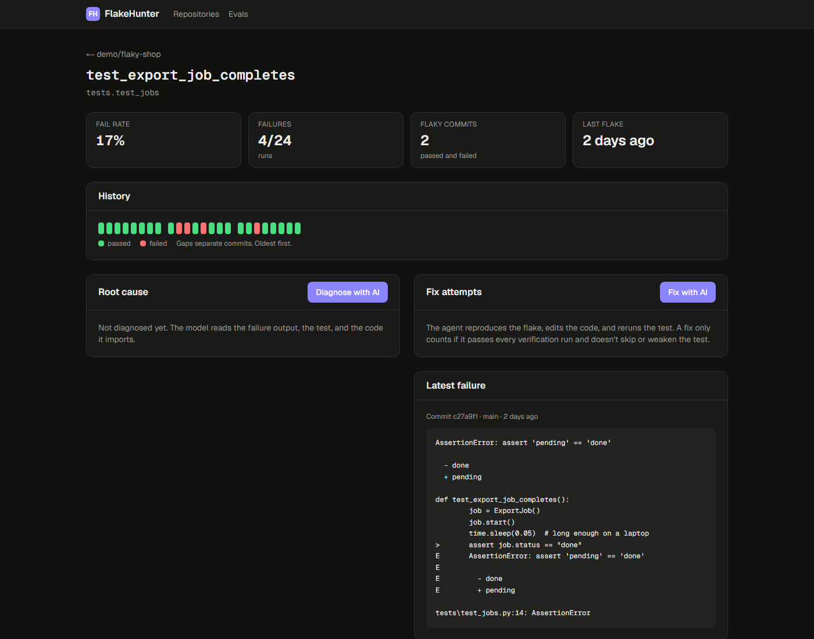
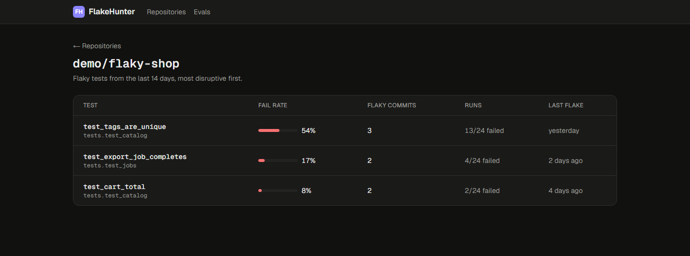

# FlakeHunter

Finds flaky tests in your CI, explains why they flake, and fixes them with an AI agent.
A fix is only reported when the test **passes every one of 100 fresh-process reruns** and
the change doesn't skip, delete, or weaken the test.



<details>
<summary>Flaky tests ranked for a repository</summary>



</details>

<!-- TODO: add a screenshot of a real AI fix attempt (trace, diff, 100/100 verification) once evals have run. -->

## How it works

```
 CI (JUnit XML) ──upload / GitHub webhook──> Detect ──> Diagnose ──> Fix agent ──> Verify ──> Pull request
                                              │           │             │            │
                              same-commit pass+fail   Claude, streamed   edit + rerun   100 fresh runs
                                                      structured output  in a sandbox   + integrity checks
```

1. **Detect.** A test is flaky when it both passed and failed **on the same commit**. Same
   code with a different outcome means nondeterminism. A real regression never matches this
   rule, because a test broken by a commit fails consistently on that commit.
2. **Diagnose.** Claude reads the CI history, failure output, the test, and the local
   modules and `conftest.py` files it depends on. It returns a structured root cause
   (category, evidence, suggested fix) and its reasoning streams to the dashboard.
3. **Fix.** An agent with four tools (`list_files`, `read_file`, `edit_file`, `run_test`)
   reproduces the flake, edits the code, and reruns the test until it's stable. Every step
   is recorded and shown as a trace.
4. **Verify.** The harness doesn't trust the agent. It reruns the test 100 times in fresh
   processes, 8 in parallel (so flakes that only show up under `pytest-xdist` appear too),
   and checks the diff:
   - **Rejected** if it adds `skip`, `xfail`, or rerun markers, removes or renames the test,
     or leaves it with no assertions.
   - **Flagged for review** if it removes some assertions. Sometimes the assertion was the bug.
5. **Pull request.** One click opens a PR with the explanation and before/after numbers.
   A human decides; nothing is pushed automatically.

## Evals

`evals/cases/` has 8 small projects, each with a planted flaky test and a known root cause.
Each case is scored on whether the diagnosis gets the category right and whether the fix
passes verification.

| Case | Root cause | Flake rate |
|---|---|---|
| `timing_race` | fixed `sleep` racing a background thread | ~20% |
| `slow_threshold` | wall-clock assertion in a functional test | ~10% |
| `async_order` | results collected in completion order | ~40% |
| `counter_race` | unlocked read-modify-write across threads | ~28% |
| `hash_order` | set iteration order depends on `PYTHONHASHSEED` | ~52% |
| `float_sum` | set order plus non-associative float addition | ~32% |
| `unseeded_random` | random value that usually, but not always, has a digit | ~18% |
| `shared_file` | parallel runs overwrite the same file (only flakes in parallel) | ~10% |

```powershell
python evals/measure_flake_rate.py      # flake rate of each case, no API key needed
python evals/run_evals.py               # full diagnosis + fix eval; needs ANTHROPIC_API_KEY
```

Results are written to `evals/results/latest.json` and shown on the dashboard's **Evals**
page. Evals run the same code path as production, against a throwaway database.

## Quickstart

Requirements: Python 3.12+, Node 20+.

```powershell
# API
python -m venv .venv
.\.venv\Scripts\activate
pip install -e ".[dev]"
copy .env.example .env          # then set ANTHROPIC_API_KEY
python scripts/seed_demo.py     # 24 simulated CI runs of demo/flaky-shop
uvicorn flakehunter.main:create_app --factory --reload

# Dashboard (second terminal)
cd web
npm install
npm run dev                     # http://localhost:3000
```

Open **demo/flaky-shop**, choose a flaky test, then **Diagnose with AI** and **Fix with AI**.

Or run everything with Docker: `docker compose up --build` (Postgres, API, dashboard).

## Getting results in

**Upload API.** Works with any CI, like Codecov:

```yaml
- run: pytest --junitxml=report.xml
- if: always()
  run: |
    curl -fsS -X POST "$FLAKEHUNTER_URL/api/repos/${{ github.repository }}/runs" \
      -H "Authorization: Bearer ${{ secrets.FLAKEHUNTER_TOKEN }}" \
      -F commit_sha=${{ github.sha }} -F branch=${{ github.ref_name }} \
      -F ci_run_id=${{ github.run_id }} -F run_attempt=${{ github.run_attempt }} \
      -F files=@report.xml
```

**GitHub App.** Subscribe to `workflow_run` events and upload reports as an artifact whose
name matches `junit|test-results`. The App also lets the agent clone the repository and
open pull requests. Required permissions: Actions (read), Contents (read & write), Pull
requests (read & write).

## API

| Method | Path | Purpose |
|---|---|---|
| `POST` | `/api/repos/{owner}/{repo}/runs` | Upload JUnit reports for one CI run (idempotent per run and attempt) |
| `GET` | `/api/repos` | Repositories with flaky-test counts |
| `GET` | `/api/repos/{owner}/{repo}/flaky-tests` | Ranked flaky tests |
| `GET` | `/api/repos/{owner}/{repo}/tests/{id}` | Stats, history, latest diagnosis, fix attempts |
| `POST` | `/api/repos/{owner}/{repo}/tests/{id}/diagnose` | Diagnose (server-sent events: status, thinking, result) |
| `POST` | `/api/repos/{owner}/{repo}/tests/{id}/fix` | Start a fix attempt |
| `GET` | `/api/fix-attempts/{id}` | Status, verification, diff, agent trace, cost |
| `POST` | `/api/fix-attempts/{id}/pull-request` | Open a PR for a verified fix |
| `GET` | `/api/evals/latest` | Latest eval results |
| `POST` | `/webhooks/github` | GitHub App webhook (HMAC-verified) |

Interactive docs at http://localhost:8000/docs.

## Design decisions

- **Same-commit detection rather than fail-rate thresholds.** A threshold flags real
  regressions that get fixed a day later. Same-commit evidence has no such false positives,
  and every "Re-run failed jobs" click becomes free signal.
- **Verification belongs to the harness, not the agent.** The agent's own runs only guide
  it. Fixes are judged by 100 independent fresh-process runs plus static integrity checks,
  so the agent can't "fix" a test by skipping it.
- **Fresh process per run.** Some flakes (hash-seed ordering) can't show up when rerunning
  inside one interpreter.
- **The model is called through one thin seam** (`client.beta.messages`), so tests run the
  whole pipeline with a scripted fake: no network, no cost.
- **Cost is tracked per request** (prompt caching on the agent loop, priced by the model that
  actually served the request) and shown next to every diagnosis and fix.

## Configuration

Environment variables (or `.env`). See `.env.example` for all of them.

| Variable | Default | |
|---|---|---|
| `ANTHROPIC_API_KEY` | unset | Needed for diagnosis and fixes |
| `FLAKEHUNTER_ANTHROPIC_MODEL` | `claude-opus-5-5` | `claude-haiku-5-5` is ~40x cheaper; set `FLAKEHUNTER_AI_FALLBACKS=false` with it |
| `FLAKEHUNTER_AI_EFFORT` | `high` | `low` to `max`; trades cost against depth |
| `FLAKEHUNTER_VERIFY_RUNS` | `100` | Reruns a fix must pass |
| `FLAKEHUNTER_SANDBOX` | `subprocess` | `docker` for untrusted code (build `Dockerfile.sandbox`) |
| `FLAKEHUNTER_AI_ENABLED` | `true` | `false` for a read-only public demo |
| `FLAKEHUNTER_ALLOW_LOCAL_REPOS` | `false` | Dev and evals: work on local checkouts |
| `FLAKEHUNTER_DATABASE_URL` | `sqlite:///./flakehunter.db` | `postgresql+psycopg://...` in production |
| `FLAKEHUNTER_UPLOAD_TOKEN` | unset | Uploads are disabled until set |
| `FLAKEHUNTER_GITHUB_APP_ID`, `..._PRIVATE_KEY_PATH`, `..._WEBHOOK_SECRET` | unset | GitHub App |

## Security

- Reports are parsed with `defusedxml`; artifact downloads are size-capped.
- Webhooks are HMAC-verified with constant-time comparison.
- Agent file paths are confined to the checkout; each job runs on a throwaway copy.
- The `subprocess` sandbox runs test code with the server's permissions. Use it only for
  repositories you trust. The `docker` sandbox runs each batch with no network and capped
  CPU and memory.

## Development

```powershell
pytest                              # 57 tests, no network or API key needed
ruff check . ; ruff format --check .
cd web; npm run lint; npm run build
```

## Known gaps

- Database migrations (Alembic); tables are created on startup.
- Fix attempts run as FastAPI background tasks; a durable queue would survive restarts.
- One upload token for the whole server rather than per repository.
- Python and pytest only.
